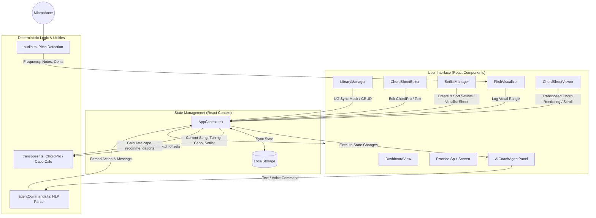

# React + TypeScript + Vite

This template provides a minimal setup to get React working in Vite with HMR and some ESLint rules.

Currently, two official plugins are available:

- [@vitejs/plugin-react](https://github.com/vitejs/vite-plugin-react/blob/main/packages/plugin-react) uses [Oxc](https://oxc.rs)
- [@vitejs/plugin-react-swc](https://github.com/vitejs/vite-plugin-react/blob/main/packages/plugin-react-swc) uses [SWC](https://swc.rs/)

## React Compiler

The React Compiler is not enabled on this template because of its impact on dev & build performances. To add it, see [this documentation](https://react.dev/learn/react-compiler/installation).

## Expanding the ESLint configuration

If you are developing a production application, we recommend updating the configuration to enable type-aware lint rules:

```js
export default defineConfig([
  globalIgnores(['dist']),
  {
    files: ['**/*.{ts,tsx}'],
    extends: [
      // Other configs...

      // Remove tseslint.configs.recommended and replace with this
      tseslint.configs.recommendedTypeChecked,
      // Alternatively, use this for stricter rules
      tseslint.configs.strictTypeChecked,
      // Optionally, add this for stylistic rules
      tseslint.configs.stylisticTypeChecked,

      // Other configs...
    ],
    languageOptions: {
      parserOptions: {
        project: ['./tsconfig.node.json', './tsconfig.app.json'],
        tsconfigRootDir: import.meta.dirname,
      },
      // other options...
    },
  },
])
```

You can also install [eslint-plugin-react-x](https://github.com/Rel1cx/eslint-react/tree/main/packages/plugins/eslint-plugin-react-x) and [eslint-plugin-react-dom](https://github.com/Rel1cx/eslint-react/tree/main/packages/plugins/eslint-plugin-react-dom) for React-specific lint rules:

```js
// eslint.config.js
import reactX from 'eslint-plugin-react-x'
import reactDom from 'eslint-plugin-react-dom'

export default defineConfig([
  globalIgnores(['dist']),
  {
    files: ['**/*.{ts,tsx}'],
    extends: [
      // Other configs...
      // Enable lint rules for React
      reactX.configs['recommended-typescript'],
      // Enable lint rules for React DOM
      reactDom.configs.recommended,
    ],
    languageOptions: {
      parserOptions: {
        project: ['./tsconfig.node.json', './tsconfig.app.json'],
        tsconfigRootDir: import.meta.dirname,
      },
      // other options...
    },
  },
])
```

## Application Flow

Phineas is built as a highly responsive, single-page client-side web application using React, TypeScript, and Vite. To keep LLM costs entirely manageable and performance instant, all pitch-tracking, transposition, capo calculations, and NLP commands are executed locally and deterministically.

### Architecture & Data Flow



### Detailed Flow Explanation

1. **Audio Input & Pitch Detection**:
   * The **Microphone Input** is routed through a Web Audio API `AnalyserNode`.
   * **`audio.ts`** reads the time-domain buffer and uses **Autocorrelation** to determine the pitch frequency (50 Hz to 2000 Hz).
   * If the signal amplitude is above the root-mean-square threshold, it resolves the frequency to a MIDI note number, name, and cents deviation (-50 cents to +50 cents).
   * **`PitchVisualizer.tsx`** displays the live tuner dial and records the user's vocal range limits (comfortable min/max pitch), writing it to the `AppContext`.

2. **State & LocalStorage Sync**:
   * **`AppContext.tsx`** stores the unified app state (active song, guitar tuning standard/Eb/baritone, capo fret, vocal range, custom setlists, library, and chat logs).
   * Any mutation of the state is automatically persisted into the user's browser via **`localStorage`**, enabling offline practice.

3. **Deterministic Command NLP Parsing**:
   * The **`AICoachAgentPanel.tsx`** captures user commands (via text typing or Web Speech API recognition).
   * Instead of sending requests to a costly external LLM, **`agentCommands.ts`** processes inputs locally using regular expression pattern matching.
   * Actions like `transpose`, `set_capo`, `set_tuning`, `create_setlist`, and `stretch_vocals` are dispatched to `AppContext` which mutates state deterministically.

4. **Chord Transposition & Capo Optimization**:
   * **`transposer.ts`** handles parsing ChordPro metadata/bracket notations and standard text.
   * Key transposition maps each chord symbol to its offset value. Slash chords (e.g. `C/E`) are parsed and both halves transposed correctly.
   * Capo recommendations are calculated by mapping the target concert key against the guitar's tuning offset (Standard: 0, Eb: -1, Baritone: -5) and finding the capo fret (0 to 11) that maximizes the usage of easy open chords (`G`, `C`, `D`, `E`, `A`).

5. **Setlist Compilation & Vocalist Print Sheets**:
   * **`SetlistManager.tsx`** builds gig setlists, estimates duration, and toggles "Vocalist Mode".
   * In Vocalist Mode, the layout strips all chord brackets and guitar-oriented symbols, showing only large, print-friendly lyrics.

